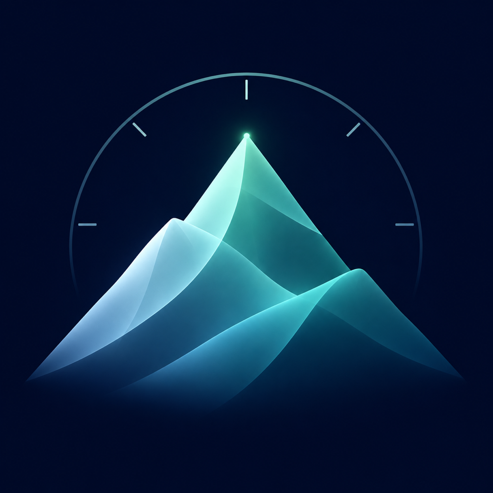
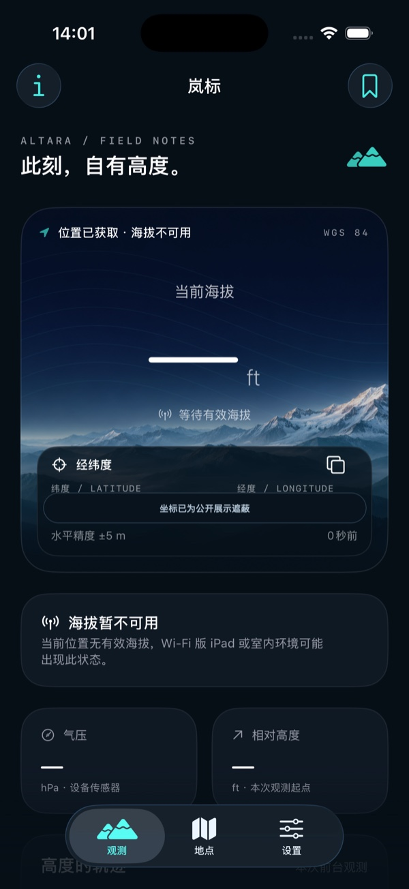
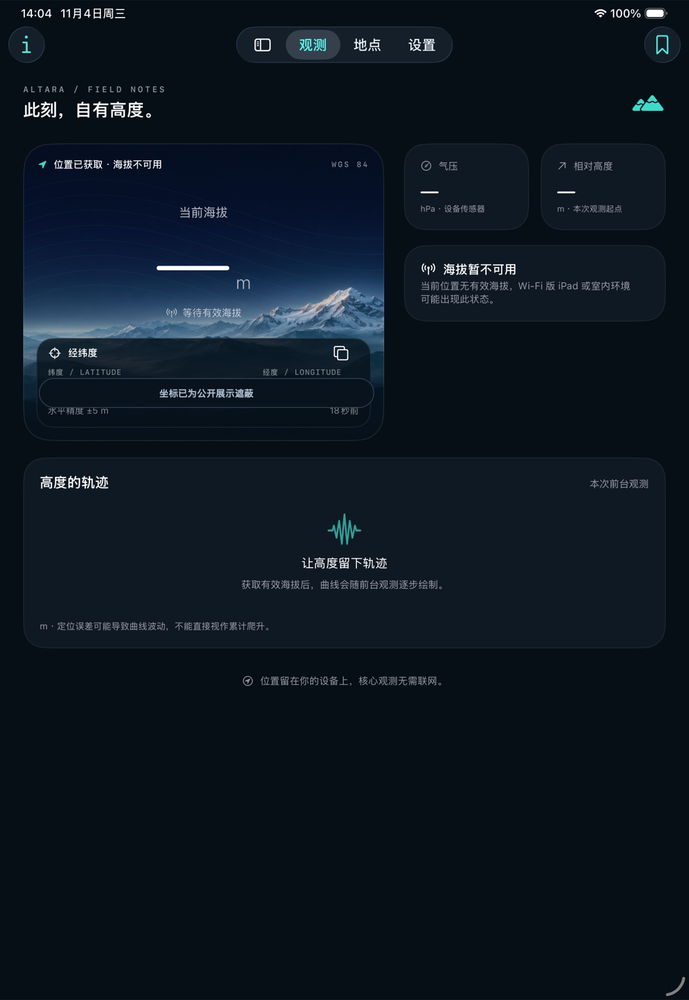
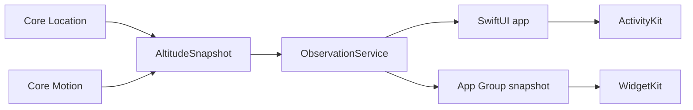

<div align="center">
  
  <h1>岚标 · Altara</h1>
  <p><strong>在此刻，读懂所在的高度。</strong></p>
  <p>为 iPhone 与 iPad 设计的原生海拔和坐标观测工具</p>
  <p>
    
    
    
    
    
  </p>
</div>

## 产品概览

岚标把当前位置、海拔、设备气压与本次观测轨迹放在一个安静、清晰的原生界面里。它优先呈现设备实际提供的读数、数据来源、观测时间与精度；设备无法提供有效海拔时，明确显示不可用状态，不以零值、地图地形或未经校准的气压估算补齐。

项目采用 SwiftUI 与 Apple 系统框架实现，支持 iPhone 和 iPad 自适应布局。核心观测无需账号或自建服务；收藏地点保存在设备本地。地图底图由 MapKit 加载，使用地图时需要网络。

## 页面预览

<table>
  <tr>
    <th align="center">iPhone · 纵向观测页</th>
    <th align="center">iPad · 自适应工作区</th>
  </tr>
  <tr>
    <td align="center"></td>
    <td align="center"></td>
  </tr>
</table>

> 页面图来自模拟器运行画面。截图展示“位置已获取、有效海拔暂不可用”的真实界面状态；经纬度已在发布副本中遮蔽。装饰山景仅用于视觉表达，不代表当前位置地形。

## 功能

| 模块 | 能力 | 数据边界 |
| --- | --- | --- |
| 现场观测 | 同屏显示海拔、坐标、水平精度、数据来源与观测时间 | 海拔仅在系统返回有效垂直精度时显示；无效值显示占位 |
| 气压与相对高度 | 读取设备气压计并展示气压和本次相对高度 | 设备不支持或数据不可用时如实隐藏；相对高度不等于绝对海拔 |
| 本次轨迹 | 前台观测期间绘制海拔变化 | 最多保留 240 个有效采样点；不是全天记录，也不代表累计爬升 |
| 地点收藏 | 地图选点、名称与备注、观测快照、复制坐标及系统分享 | 收藏保存在当前设备，不提供账号同步 |
| 小组件 | 桌面与锁屏小组件，展示最近的有效读数 | WidgetKit 按系统策略刷新，不承诺连续或按秒更新 |
| 实时活动 | 前台观测时向锁屏与灵动岛呈现最近读数 | 不是后台持续定位；旧读数会按时间标记 |
| iPad 布局 | 宽屏分栏与系统侧栏，沿用原生交互 | 页面随系统尺寸类别与窗口宽度调整 |

## 技术设计

- **界面：** SwiftUI、原生系统控件与自适应布局。
- **观测：** Core Location 提供位置、坐标、水平/垂直精度及时间；Core Motion 提供设备支持时的气压和相对高度。
- **地图：** MapKit 用于地点选择与系统地图跳转。
- **共享与系统表面：** App Group 在应用和 WidgetKit 扩展间共享最近快照；WidgetKit 和 ActivityKit 分别呈现小组件与实时活动。
- **数据原则：** 不从气压推导未经校准的绝对海拔；位置时间只随新的有效定位更新；过期数据保留原时间，不伪装成实时读数。
- **依赖：** 无第三方运行时依赖。



## 数据与设备限制

- 海拔是否可用取决于系统定位结果和设备能力。Wi‑Fi 版 iPad、室内环境或信号条件较差时，系统可能只返回坐标。
- 精度是系统估计值，不是固定误差保证；定位轨迹可能受环境和设备误差影响。
- 气压计数据为设备传感器读数。没有校准基准时，不将其转换为绝对海拔。
- 小组件刷新由系统调度；后台和锁屏的更新频率不由应用保证。
- 地图内容需要网络；收藏和最近观测快照使用本地持久化及 App Group 共享容器。
- 本项目没有体验模式或样例读数开关，界面不会把示例数据作为测量值展示。

## 开始使用

### 环境要求

- Xcode 26 或更新版本
- iOS / iPadOS 26.0 或更新版本
- Swift 5 语言模式

项目最后已知的本机构建环境为 Xcode 26.3 与 iOS 26.2 SDK。源代码不包含签名证书或描述文件；真机安装需要在 Xcode 中选择自己的开发团队，并为应用与 Widget 扩展配置匹配的 App Group 权限。

### 在 Xcode 中运行

1. 打开 `Altara.xcodeproj`。
2. 选择共享 Scheme `Altara`。
3. 选择 iPhone 或 iPad 模拟器并运行。
4. 首次定位时按系统提示授权；有效海拔和气压读数取决于模拟器或设备实际提供的数据。

### 命令行构建

```sh
xcodebuild \
  -project Altara.xcodeproj \
  -scheme Altara \
  -configuration Release \
  -sdk iphoneos \
  -destination 'generic/platform=iOS' \
  -derivedDataPath /tmp/altara-derived-data \
  CODE_SIGNING_ALLOWED=NO \
  build
```

此命令构建未签名的 iOS 设备目标产物，不会生成可直接安装的签名 IPA。

### 核心逻辑检查

`Tests/AltitudeLogicTests.swift` 是 Foundation-only 的独立检查入口，覆盖单位转换、坐标格式与范围、缺失/非有限数值、精度校验、读数新鲜度和快照编码兼容性：

```sh
swiftc \
  -parse-as-library \
  -module-cache-path /tmp/altara-swift-cache \
  Shared/AltitudeData.swift \
  Tests/AltitudeLogicTests.swift \
  -o /tmp/altara-logic-tests
/tmp/altara-logic-tests
```

## 验证状态

截至 2026-11-05 的项目记录：24 项核心逻辑检查通过；iPhone 与 iPad 模拟器启动及主要交互路径已检查；Release 设备目标曾成功构建。真实设备上的传感器精度、耗电、签名安装和 iOS 27.3 运行尚未完成验收。WidgetKit 多日刷新及锁屏/后台持续更新也不作保证。

本次 GitHub 整理没有重新运行构建或测试。

## 项目结构

```text
Altara.xcodeproj/         Xcode project and shared scheme
Altara/                 SwiftUI 应用、观测服务、地点与设置页面
AltaraWidgets/          桌面小组件、锁屏小组件与实时活动
Shared/                 观测模型、有效性判断与共享快照存储
Tests/                  Foundation-only 核心逻辑检查
docs/images/             README 页面图（经纬度已遮蔽）
```

## 设计依据

- [SwiftUI](https://developer.apple.com/documentation/swiftui)
- [Core Location](https://developer.apple.com/documentation/corelocation)
- [Core Motion](https://developer.apple.com/documentation/coremotion)
- [MapKit](https://developer.apple.com/documentation/mapkit)
- [WidgetKit](https://developer.apple.com/documentation/widgetkit)
- [ActivityKit](https://developer.apple.com/documentation/activitykit)

---

<div align="center"><sub>岚标 · Altara — 以真实设备读数为准，让每个缺失值也清晰可见。</sub></div>

## English

Altara is a native SwiftUI altitude and coordinate observation app for iPhone and iPad. It reports system location, accuracy and observation time, and uses Core Motion for barometric pressure and relative altitude when supported. Unavailable measurements remain unavailable; pressure is not presented as calibrated absolute altitude. The project targets iOS/iPadOS 26.0+, has no third-party runtime dependencies, and uses system-scheduled WidgetKit refreshes. README screenshots are simulator captures with precise coordinates redacted.
